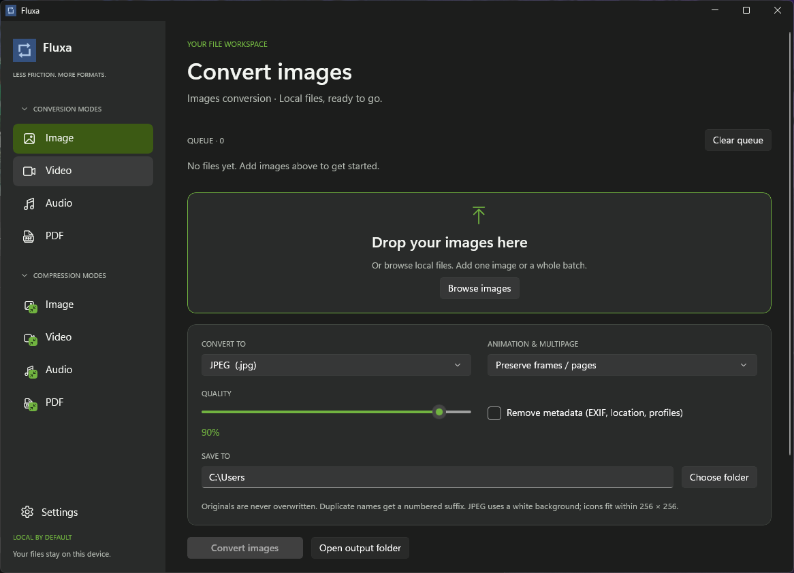

# Fluxa

A native **C# / WinUI 3** desktop file converter for Windows. Everything runs locally on your machine.

Currently supported:
- **Image conversion** (PNG, JPEG, WebP, AVIF, TIFF, BMP, GIF, ICO, JPEG XL, and more)
- **Video conversion** (MP4, WebM, MKV, MOV, AVI, and animated GIF via FFmpeg)

Audio conversion, PDF tools, and compression modes are planned for future releases.

## Screenshot



## Run

Download the portable Windows x64 ZIP from Releases, extract the full folder, and launch `dist/Fluxa.exe` (or run `Start.ps1` with PowerShell). Keep the `dist` folder intact—Fluxa is a self-contained build and needs the files next to the executable.

For video conversion, make sure [FFmpeg](https://ffmpeg.org/) is installed (`winget install Gyan.FFmpeg`) or place `ffmpeg.exe` in the app directory.

Requires Windows 10 (build 19041) or Windows 11 x64.

## Features

- **Batch queue:** Drag and drop files or browse to queue up to 500 items at a time. Completed files move to the **Finished** list while failed or cancelled items stay in the queue so you can retry them. Originals are never overwritten; duplicate output names get ` (1)`, ` (2)`, etc.
- **Image options:** Quality slider for lossy formats, metadata stripping (EXIF, location, color profiles), and frame handling (**Preserve frames / pages** or **First frame only**).
- **Video options:** Quality presets (**High**, **Balanced**, **Compact**), audio track toggle, and container metadata removal.
- **Explorer context menu:** Right-click supported images in File Explorer to **Convert with Fluxa** or **Open in Fluxa**. Can be toggled or configured in Settings.
- **System tray:** Optional close-to-tray behavior and quick mode switching from the tray icon.
- **Themes:** Dark and Light modes with six accent palettes (Blue, Green, Purple, Red, Orange, Yellow).

## Supported Formats

- **Images:** PNG, JPEG, WebP, AVIF, TIFF, BMP, GIF, ICO, JPEG XL, JPEG 2000, TGA, PSD, OpenEXR, Radiance HDR, PPM, PGM, PBM, QOI, DDS, PCX, XBM (plus HEIC/HEIF import).
- **Video:**
  - **Input:** `.mp4`, `.mkv`, `.mov`, `.webm`, `.avi`, `.wmv`, `.flv`, `.m4v`, `.mpg`, `.mpeg`, `.ts`, `.mts`, `.3gp`, `.ogv`
  - **Output:** MP4 (H.264), WebM (VP9), MKV (H.264), MOV (H.264), AVI (MPEG-4), Animated GIF

## Build from Source

Prerequisites: Windows x64, .NET 8 SDK, and Windows App SDK / WinUI build tools.

```powershell
dotnet build .\Fluxa.sln -c Release -p:Platform=x64
dotnet test .\tests\Fluxa.Tests\Fluxa.Tests.csproj -c Release
.\scripts\Publish.ps1
```

See [CHANGELOG.md](CHANGELOG.md) for release notes.
